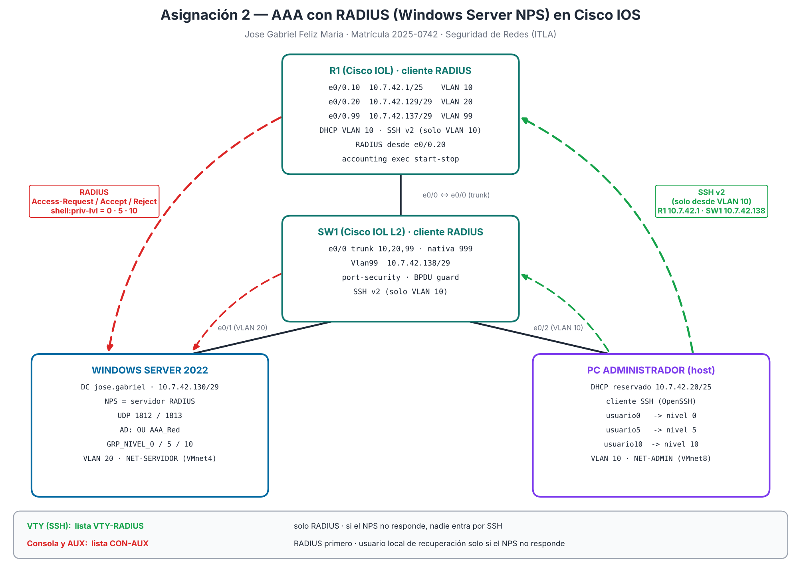
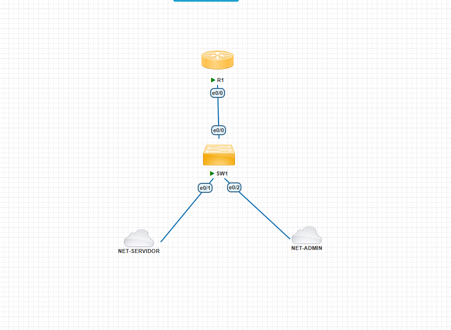
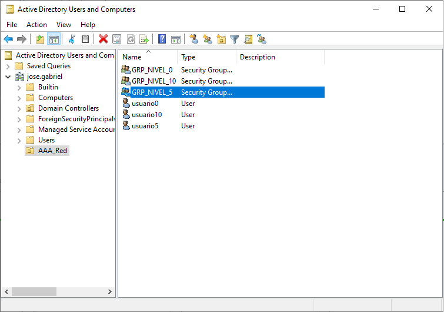
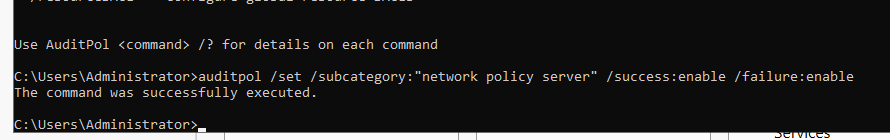
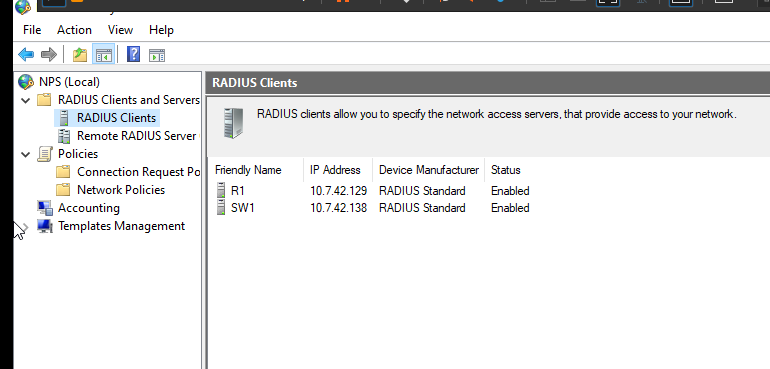
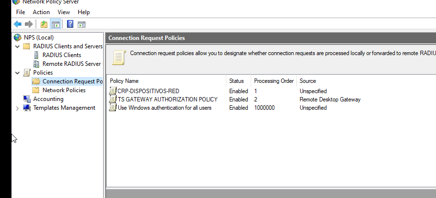
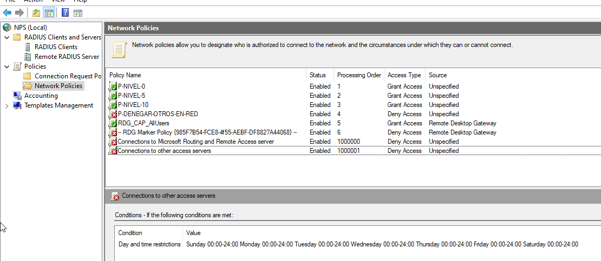

# Asignación 2 — AAA con RADIUS (Windows Server NPS) en Cisco IOS

**Jose Gabriel Feliz Maria · Matrícula: 2025-0742**
**Seguridad de Redes · ITLA**

---

## 🎥 Video Demostrativo

**[Ver demostración en YouTube](PENDIENTE_LINK_VIDEO)**

En el video se muestra la hora y fecha del sistema, el rostro y la voz del autor, y la demostración de que R1 y SW1 autentican y autorizan contra el NPS: cada usuario del dominio entra por SSH con el nivel de privilegio de su grupo (0, 5 o 10), los accesos inválidos se rechazan y quedan registrados, y el usuario local de recuperación solo funciona por consola cuando el servidor RADIUS no responde.

---

## 📋 Tabla de Contenido

1. [Propósito del Laboratorio](#1-propósito-del-laboratorio)
2. [Topología](#2-topología)
3. [Direccionamiento IP](#3-direccionamiento-ip)
4. [Decisiones de Diseño](#4-decisiones-de-diseño)
5. [Windows Server: Active Directory](#5-windows-server-active-directory)
6. [Windows Server: NPS (servidor RADIUS)](#6-windows-server-nps-servidor-radius)
7. [R1 y SW1: AAA, RADIUS y SSH](#7-r1-y-sw1-aaa-radius-y-ssh)
8. [Niveles de Privilegio](#8-niveles-de-privilegio)
9. [Registros (Logs)](#9-registros-logs)
10. [Pruebas y Verificación](#10-pruebas-y-verificación)
11. [Problemas Encontrados y Soluciones](#11-problemas-encontrados-y-soluciones)
12. [Scripts y Running-Configs](#12-scripts-y-running-configs)
13. [Evidencias (Capturas)](#13-evidencias-capturas)
14. [Notas y Limitaciones del Laboratorio](#14-notas-y-limitaciones-del-laboratorio)

---

## 1. Propósito del Laboratorio

Centralizar en un servidor la **autenticación, la autorización y el registro (AAA)** de los equipos de red, en lugar de tener usuarios locales en cada router y switch. Un **Windows Server** con **Active Directory** y el rol **NPS** (Network Policy Server) actúa como servidor **RADIUS**; el router **R1** y el switch **SW1** son sus clientes. Lo que pide la asignación:

**Router y switch**

1. Seguridad en **todos los niveles** de autenticación y autorización (consola, auxiliar, VTY y enable).
2. Configurados como **cliente RADIUS** del NPS.
3. Un **usuario local**, y que la autenticación y autorización con ese usuario solo se permita por los puertos de **consola y auxiliar**.
4. **Registros (logs)** de autenticación, autorización y RADIUS.
5. Acceso remoto por **SSH**.

**Servidor**

6. **Active Directory** con grupos de **nivel 0, 5 y 10**.
7. Servicio **NPS** que entrega a cada grupo su nivel de privilegio.

---

## 2. Topología



Topología montada en PNETLab:



| Equipo | Rol |
|---|---|
| **R1** | Router Cisco IOL. Router entre VLAN (router-on-a-stick por `e0/0`), DHCP de la VLAN 10, cliente RADIUS y destino SSH |
| **SW1** | Switch Cisco IOL L2. Conecta el servidor (VLAN 20) y la PC de administración (VLAN 10); gestión en la VLAN 99; cliente RADIUS y destino SSH |
| **Windows Server 2022** | Controlador del dominio `jose.gabriel` y servidor **NPS** (RADIUS). Conectado por la nube **NET-SERVIDOR** (VMnet4) |
| **PC administrador** | El PC host, conectado por la nube **NET-ADMIN** (VMnet8). Es el **cliente SSH** |

---

## 3. Direccionamiento IP

| VLAN | Nombre | Red | Gateway (R1) | Equipos |
|---|---|---|---|---|
| 10 | ADMINISTRACION | `10.7.42.0/25` | `10.7.42.1` | PC administrador `10.7.42.20` (DHCP con reserva por MAC) |
| 20 | SERVIDORES | `10.7.42.128/29` | `10.7.42.129` | Windows Server AD/NPS `10.7.42.130` |
| 99 | GESTION | `10.7.42.136/29` | `10.7.42.137` | SW1 `Vlan99` `10.7.42.138` |
| 999 | SIN-USO | — | — | VLAN nativa del trunk y puertos sin uso (apagados) |

| Equipo | Interfaz | Dirección |
|---|---|---|
| R1 | `e0/0.10` / `e0/0.20` / `e0/0.99` | `10.7.42.1/25` / `10.7.42.129/29` / `10.7.42.137/29` |
| SW1 | `Vlan99` | `10.7.42.138/29` · gateway `10.7.42.137` |
| Windows Server | NIC (VMnet4) | `10.7.42.130/29` · gateway `10.7.42.129` |

---

## 4. Decisiones de Diseño

- **Tres VLAN separadas.** La administración (VLAN 10), los servidores (VLAN 20) y la gestión del switch (VLAN 99) no comparten red; todo pasa por R1. SSH solo se acepta desde la VLAN 10 (`access-class 10` en las VTY).
- **Dos listas de autenticación distintas:**
  - `VTY-RADIUS` (SSH): **solo RADIUS**. Si el NPS no responde, nadie entra por la red.
  - `CON-AUX` (consola y auxiliar): **RADIUS y después `local`**. El usuario local solo se usa cuando el NPS **no responde**; si el NPS **rechaza** a un usuario, el router no prueba el local. Así el usuario de recuperación solo existe en la práctica por consola o auxiliar y solo durante una caída del servidor.
- **El nivel lo decide el servidor.** Con `aaa authorization exec`, el NPS devuelve el atributo `shell:priv-lvl` según el grupo del usuario; el router no tiene usuarios por nivel.
- **`aaa authorization console`**: sin este comando IOS no aplica la autorización en la consola; con él, la consola también recibe el nivel del NPS.
- **Usuario local de recuperación** con nombre poco obvio, clave fuerte y nivel 15 (recomendación del profesor). Su clave **no se publica** en este repositorio; el nombre aparece en las evidencias porque la prueba exige escribirlo.
- **Claves cifradas con scrypt (tipo 9)**, longitud mínima de 10 (`security passwords min-length 10`) y `service password-encryption` para el secreto RADIUS en la configuración.
- **`ip radius source-interface`**: R1 manda RADIUS siempre desde `e0/0.20` (`10.7.42.129`) y SW1 desde `Vlan99` (`10.7.42.138`), que son las IP registradas como clientes en el NPS.
- **Una directiva de solicitud de conexión propia** (`CRP-DISPOSITIVOS-RED`, orden 1) porque el servidor ya tenía la del Remote Desktop Gateway, que acepta solicitudes sin validar la clave (ver [11](#11-problemas-encontrados-y-soluciones)).
- **Una directiva de denegación** (`P-DENEGAR-OTROS-EN-RED`) después de las tres de nivel, para que ningún otro usuario del dominio entre a R1 o SW1 por una directiva de otro servicio.
- **Protección contra fuerza bruta**: `login block-for 60 attempts 5 within 60` bloquea los accesos por 60 segundos tras 5 fallos en un minuto.

---

## 5. Windows Server: Active Directory

Todo se hizo por **interfaz gráfica** (Usuarios y equipos de Active Directory). El equivalente en PowerShell está en [`scripts/SRV_AD_NPS.ps1`](scripts/SRV_AD_NPS.ps1).

| Objeto | Nombre | Detalle |
|---|---|---|
| Unidad organizativa | `AAA_Red` | Contiene todo lo de la asignación |
| Grupo de seguridad global | `GRP_NIVEL_0` | Miembro: `usuario0` |
| Grupo de seguridad global | `GRP_NIVEL_5` | Miembro: `usuario5` |
| Grupo de seguridad global | `GRP_NIVEL_10` | Miembro: `usuario10` |



---

## 6. Windows Server: NPS (servidor RADIUS)

Rol **Network Policy and Access Services**, registrado en Active Directory, y la auditoría de NPS activada para que cada intento quede en el Visor de eventos (6272 = concedido, 6273 = denegado):

```
auditpol /set /subcategory:"Network Policy Server" /success:enable /failure:enable
```



### 6.1 Clientes RADIUS

| Nombre | Dirección | Secreto compartido |
|---|---|---|
| `R1` | `10.7.42.129` | Secreto largo (letras y números), el mismo que `key` en R1. No se publica |
| `SW1` | `10.7.42.138` | El mismo, configurado en SW1. No se publica |



### 6.2 Directiva de solicitud de conexión

| Orden | Directiva | Condición | Acción |
|---|---|---|---|
| 1 | `CRP-DISPOSITIVOS-RED` | Client Friendly Name = `R1\|SW1` | Autenticar en este servidor |
| 2 | `TS GATEWAY AUTHORIZATION POLICY` | (del Remote Desktop Gateway) | — |



### 6.3 Directivas de red

| Orden | Directiva | Acceso | Condición | Configuración |
|---|---|---|---|---|
| 1 | `P-NIVEL-0` | Conceder | Grupo `GRP_NIVEL_0` | PAP · `Service-Type = Login` · `Cisco-AV-Pair = shell:priv-lvl=0` |
| 2 | `P-NIVEL-5` | Conceder | Grupo `GRP_NIVEL_5` | PAP · `Service-Type = Login` · `Cisco-AV-Pair = shell:priv-lvl=5` |
| 3 | `P-NIVEL-10` | Conceder | Grupo `GRP_NIVEL_10` | PAP · `Service-Type = Login` · `Cisco-AV-Pair = shell:priv-lvl=10` |
| 4 | `P-DENEGAR-OTROS-EN-RED` | Denegar | Client Friendly Name = `R1\|SW1` | Cualquier otro usuario que llegue desde R1 o SW1 |

- **PAP**: el login de IOS manda la clave en el atributo `User-Password`, protegida con el secreto compartido; por eso el secreto es largo.
- En cada directiva de nivel se quitó `Framed-Protocol = PPP` (que el asistente agrega) y se dejó `Service-Type = Login`.



---

## 7. R1 y SW1: AAA, RADIUS y SSH

Los dos equipos llevan la misma configuración de seguridad; cambian la red y la interfaz de origen de RADIUS. Configuración completa en [`scripts/R1_config.txt`](scripts/R1_config.txt) y [`scripts/SW1_config.txt`](scripts/SW1_config.txt).

```
aaa new-model
radius server NPS
 address ipv4 10.7.42.130 auth-port 1812 acct-port 1813
 key <SECRETO_RADIUS>
 timeout 5
 retransmit 2
aaa group server radius GRUPO-NPS
 server name NPS
 ip radius source-interface Ethernet0/0.20        ! en SW1: Vlan99
!
aaa authentication login default group GRUPO-NPS
aaa authentication login VTY-RADIUS group GRUPO-NPS
aaa authentication login CON-AUX group GRUPO-NPS local
aaa authentication enable default enable
aaa authorization console
aaa authorization exec default group GRUPO-NPS
aaa authorization exec VTY-RADIUS group GRUPO-NPS
aaa authorization exec CON-AUX group GRUPO-NPS local
aaa accounting exec default start-stop group GRUPO-NPS
!
line con 0
 login authentication CON-AUX
 authorization exec CON-AUX
line aux 0
 login authentication CON-AUX
 authorization exec CON-AUX
line vty 0 4
 login authentication VTY-RADIUS
 authorization exec VTY-RADIUS
 access-class 10 in
 transport input ssh
```

| Nivel de acceso | Cómo se protege |
|---|---|
| Consola | Lista `CON-AUX`: RADIUS y, solo si no responde, usuario local · timeout 10 min |
| Auxiliar | Lista `CON-AUX` (igual que la consola) · timeout 10 min |
| VTY (remoto) | Solo SSH v2 · lista `VTY-RADIUS` (sin respaldo local) · solo desde la VLAN 10 · timeout 10 min |
| Enable (nivel 15) | `enable algorithm-type scrypt secret` |
| Fuerza bruta | `login block-for 60 attempts 5 within 60` |

**SSH:** clave RSA de 2048 bits, `ip ssh version 2`, 3 intentos y 60 s de espera. Desde Windows 11 (OpenSSH 9) hay que permitir en el **comando del cliente** los algoritmos SHA-1 que ofrecen estos IOS:

```
ssh -o KexAlgorithms=+diffie-hellman-group14-sha1 -o HostKeyAlgorithms=+ssh-rsa usuario5@10.7.42.1
ssh -o KexAlgorithms=+diffie-hellman-group14-sha1 -o HostKeyAlgorithms=+ssh-rsa -o MACs=+hmac-sha1 usuario5@10.7.42.138
```

---

## 8. Niveles de Privilegio

| Nivel | Grupo / usuario | Comandos permitidos |
|---|---|---|
| **0** | `GRP_NIVEL_0` / `usuario0` | Solo `show privilege` (más los básicos de nivel 0: `enable`, `exit`, `logout`) |
| **5** | `GRP_NIVEL_5` / `usuario5` | R1: `show ip interface brief`, `show ip route`, `show interfaces`, `show logging`, `show users`, `ping`, `traceroute` · SW1: `show vlan brief`, `show interfaces status`, `show mac address-table`, `show port-security`, `show logging`, `show users`, `ping` |
| **10** | `GRP_NIVEL_10` / `usuario10` | Todo lo anterior + `configure terminal`, `interface`, `description`, `shutdown`, `show running-config`. No puede cambiar `hostname`, AAA, usuarios ni claves |
| **15** | Usuario local de recuperación / clave enable | Todo |

```
privilege exec level 0 show privilege
privilege exec level 5 show ip interface brief
privilege exec level 5 ping
privilege exec level 10 configure terminal
privilege configure level 10 interface
privilege interface level 10 description
privilege interface level 10 shutdown
privilege exec level 10 show running-config
privilege exec level 0 show
privilege exec level 0 show privilege
```

Las dos últimas líneas van **al final** por un detalle de IOS explicado en [11](#11-problemas-encontrados-y-soluciones).

---

## 9. Registros (Logs)

| Qué se registra | Dónde | Configuración |
|---|---|---|
| Inicios de sesión correctos y fallidos (usuario, IP de origen, puerto) | R1/SW1 `show logging` | `login on-success log` · `login on-failure log` |
| Bloqueo por fuerza bruta | R1/SW1 `show logging` | `login block-for` → `%SEC_LOGIN-1-QUIET_MODE_ON` |
| Cada comando de configuración, con el usuario que lo escribió (claves ocultas) | R1/SW1 `show logging` | `archive` → `log config` → `hidekeys` |
| Autenticación, autorización y paquetes RADIUS | R1/SW1 (depuración) | `debug aaa authentication` · `debug aaa authorization` · `debug radius authentication` |
| Inicio y fin de cada sesión | NPS (accounting) | `aaa accounting exec default start-stop group GRUPO-NPS` |
| Acceso concedido / denegado y el motivo | Visor de eventos del servidor | Auditoría de NPS: eventos **6272** / **6273** (captura 28) |

`logging buffered 64000 debugging` guarda también la salida de los `debug` en el búfer, con fecha y hora (`service timestamps ... localtime show-timezone`).

---

## 10. Pruebas y Verificación

| # | Prueba | Resultado esperado | Resultado | Evidencia |
|---|---|---|---|---|
| 1 | R1 y SW1 alcanzan al NPS | `ping 10.7.42.130` OK · `show aaa servers` en **UP** | ✅ | 09, 10 |
| 2 | `test aaa` desde R1 y SW1 | `User successfully authenticated` · `priv-lvl 5` · `incorrect 0` | ✅ | — (la captura muestra la clave) |
| 3 | SSH a R1 con `usuario0` | `Current privilege level is 0` · `show ?` solo muestra `privilege` | ✅ | 11 |
| 4 | SSH a R1 con `usuario5` | Nivel 5 · `show ip interface brief` funciona · `configure terminal` rechazado | ✅ | 12 |
| 5 | SSH a R1 con `usuario10` | Nivel 10 · cambia la `description` de una interfaz · `hostname` rechazado | ✅ | 13 |
| 6 | SSH a SW1 con `usuario0` / `usuario5` / `usuario10` | Niveles 0 / 5 / 10 con las mismas restricciones | ✅ | 14, 15, 16 |
| 7 | Usuario del dominio fuera de los grupos (`pedrito`) | Rechazado (`LOGIN_FAILED`) | ✅ | 18 |
| 8 | 5 fallos en menos de 60 s | `QUIET_MODE_ON`: SSH bloqueado 60 s | ✅ | 18 |
| 9 | Clave incorrecta (`usuario5`) | `Access-Reject` del NPS · `LOGIN_FAILED` | ✅ | 19 |
| 10 | Usuario local por consola con el NPS respondiendo | Rechazado: el NPS contesta *Access-Reject* y IOS no pasa a `local` | ✅ | 20 |
| 11 | Usuario local por consola con el RADIUS sin responder | 3 × `Request timed out!` → `No response` → `LOGIN_SUCCESS` del usuario local · nivel 15 | ✅ | 21, 22 |
| 12 | Usuario local y usuario del dominio por SSH con el RADIUS sin responder | Rechazados (`LOGIN_FAILED`, puerto 22): las VTY no tienen respaldo local | ✅ | 23, 24 |
| 13 | Comandos del usuario local registrados | `logged command:no shutdown` con su nombre | ✅ | 25 |
| 14 | RADIUS de vuelta | `usuario5` entra otra vez con nivel 5 | ✅ | 26, 27 |
| 15 | Accounting | `Account: start 16 / stop 14` enviados, `start 15 / stop 13` respondidos por el NPS | ✅ | 27 |
| 16 | Registro del lado del servidor | Eventos 6272 (concedido) y 6273 (denegado) de NPS | ✅ | 28 |

**Cómo se simuló la caída del RADIUS (pruebas 11 y 12):** desde una sesión SSH de administrador abierta por la VLAN 10 se apagó la subinterfaz `Ethernet0/0.20` de R1 (`shutdown`), de modo que el R1 no recibe respuesta del NPS. Al terminar se volvió a encender (`no shutdown`, prueba 13). Ver [11.8](#118-el-nps-seguía-respondiendo-al-detener-el-servicio).

---

## 11. Problemas Encontrados y Soluciones

### 11.1 Secreto RADIUS distinto en el equipo y en el NPS
`test aaa` respondía *User rejected*. En el Visor de eventos salían tres 6273 por intento, separados 5 s (los reintentos de R1), y R1 marcaba el servidor como `RADIUS_DEAD`. En SW1, `show aaa servers` mostraba `incorrect 6`: el NPS contestaba, pero la firma no cuadraba. **Solución:** escribir el mismo secreto en el cliente del NPS y en el equipo. En Cisco **los espacios al final del secreto cuentan**.

### 11.2 Plantilla pegada sin reemplazar
El usuario local de recuperación se pegó con el nombre de la plantilla y, con la consola cerrada por inactividad y el secreto mal, no hubo forma de entrar. **Solución:** se borraron R1 y SW1 y se configuraron de cero con una hoja de claves preparada antes y un bloque único por equipo, revisado con Ctrl+F antes de pegar.

### 11.3 La directiva del Remote Desktop Gateway aceptaba sin validar la clave
El servidor ya tenía el rol RD Gateway, cuya directiva de solicitud de conexión `TS GATEWAY AUTHORIZATION POLICY` estaba en orden 1 y acepta las solicitudes sin comprobar la clave, y la directiva de red `RDG_CAP_AllUsers` concede a cualquier usuario del dominio. **Solución:** `CRP-DISPOSITIVOS-RED` en orden 1 solo para R1 y SW1, y `P-DENEGAR-OTROS-EN-RED` antes de las directivas del RD Gateway.

### 11.4 IOS sube la palabra `show` al nivel del último `show` asignado
Por SSH, `usuario0` entraba con nivel 0 pero `show privilege` daba `% Invalid input`. Al asignar `privilege exec level 5 show ...` y `level 10 show running-config`, IOS sube también la palabra `show` a ese nivel (quedó en 10), así que los niveles 0 y 5 no podían usar ningún `show`. **Solución:** al final, `privilege exec level 0 show` y otra vez `privilege exec level 0 show privilege`.

### 11.5 Windows 11 no negocia SSH con IOS antiguos
OpenSSH 9 no ofrece por defecto los algoritmos SHA-1. R1 necesitó `KexAlgorithms=+diffie-hellman-group14-sha1` y `HostKeyAlgorithms=+ssh-rsa`; SW1 (IOL L2 15.2) además solo ofrece `hmac-sha1` (*no matching MAC found*) y necesitó `MACs=+hmac-sha1`. Se habilitan solo en el comando del cliente, sin cambiar la configuración SSH de Windows.

### 11.6 `enable` durante las pruebas de nivel
En la primera ronda de SSH se usó `enable` con la clave enable, que sube a nivel 15 y oculta el nivel que entrega RADIUS (con nivel 15, `hostname PRUEBA` sí funcionó). Se devolvieron los nombres y las pruebas se repitieron sin `enable`.

### 11.7 Comando `auditpol` con un punto
El primer `auditpol` falló por escribir `.subcategory` en lugar de `/subcategory`.

### 11.8 El NPS seguía respondiendo al detener el servicio
Para probar el usuario local se detuvo el servicio NPS desde su consola, pero el debug de R1 seguía mostrando `Access-Reject` firmado en 2 ms: el servicio seguía contestando (el servidor tiene además el rol RD Gateway, que usa NPS). Con el NPS respondiendo, el rechazo es lo correcto: `CON-AUX` solo pasa a `local` cuando RADIUS **no responde**. **Solución:** simular la caída cortando el camino al servidor (`shutdown` en `Ethernet0/0.20` de R1). El debug mostró entonces 3 `Request timed out!` de 5 s, `No response from 10.7.42.130`, `Case error` y el `LOGIN_SUCCESS` del usuario local.

### 11.9 `show aaa servers` no muestra DEAD
Con el RADIUS sin responder, `show aaa servers` seguía diciendo `State: current UP`. Sin `radius-server deadtime`, IOS nunca marca el servidor como muerto y lo vuelve a intentar en cada login (por eso cada intento espera 15 s: `timeout 5` × 3 envíos). La prueba de que no respondía es el debug.

### 11.10 Comandos que la imagen del switch no acepta
IOL L2 15.2 no aceptó `security passwords min-length 10` ni `no ip http secure-server` (no tiene servidor HTTPS). Las claves igual tienen 14 o más caracteres y quedaron con scrypt (tipo 9), como muestra la running-config.

---

## 12. Scripts y Running-Configs

| Archivo | Contenido |
|---|---|
| [`scripts/R1_config.txt`](scripts/R1_config.txt) | R1 completo: red, DHCP, secretos (marcadores), AAA, RADIUS, niveles, SSH y registros |
| [`scripts/SW1_config.txt`](scripts/SW1_config.txt) | SW1 completo: VLAN, trunk, port-security, gestión, AAA, RADIUS, niveles, SSH y registros |
| [`scripts/SRV_AD_NPS.ps1`](scripts/SRV_AD_NPS.ps1) | Equivalente en PowerShell de la OU, grupos y usuarios de AD, los clientes RADIUS y la auditoría (pide las claves al ejecutarse) |
| [`running-configs/R1_running-config.txt`](running-configs/R1_running-config.txt) | `show running-config` final de R1 (secretos ocultos) |
| [`running-configs/SW1_running-config.txt`](running-configs/SW1_running-config.txt) | `show running-config` final de SW1 (secretos ocultos) |

Los scripts usan marcadores (`<CLAVE_ENABLE>`, `<USUARIO_RECUPERACION>`, `<CLAVE_RECUPERACION>`, `<SECRETO_RADIUS>`) en lugar de las claves reales.

---

## 13. Evidencias (Capturas)

| # | Captura | Qué muestra |
|---|---|---|
| 01 | [Topología PNETLab](screenshots/01_topologia_pnetlab.png) | R1, SW1, NET-SERVIDOR y NET-ADMIN |
| 02 | [SW1 trunk y ping a R1](screenshots/02_sw1_trunk_y_ping_r1.png) | Trunk 10, 20, 99 y gestión por la VLAN 99 |
| 03 | [PC: ping a SW1 y al servidor](screenshots/03_pc_ping_sw1_y_servidor.png) | Ruteo entre VLAN desde la PC de administración |
| 04 | [AD: OU, grupos y usuarios](screenshots/04_ad_ou_grupos_y_usuarios.png) | `AAA_Red`, `GRP_NIVEL_0/5/10`, `usuario0/5/10` |
| 05 | [Auditoría NPS](screenshots/05_srv_auditoria_nps.png) | `auditpol` de Network Policy Server |
| 06 | [Clientes RADIUS](screenshots/06_nps_clientes_radius.png) | R1 `10.7.42.129` y SW1 `10.7.42.138` |
| 07 | [Directivas de red](screenshots/07_nps_directivas_de_red.png) | P-NIVEL-0/5/10 y P-DENEGAR-OTROS-EN-RED |
| 08 | [Solicitud de conexión](screenshots/08_nps_directivas_solicitud_conexion.png) | CRP-DISPOSITIVOS-RED en orden 1 |
| 09 | [SW1 ping a R1 y al servidor](screenshots/09_sw1_ping_r1_y_servidor.png) | SW1 alcanza al NPS por R1 |
| 10 | [R1: RADIUS UP](screenshots/10_r1_ping_servidor_radius_up.png) | `show aaa servers` con el servidor UP |
| 11 | [R1 SSH usuario0](screenshots/11_r1_ssh_usuario0_nivel0.png) | Nivel 0 |
| 12 | [R1 SSH usuario5](screenshots/12_r1_ssh_usuario5_nivel5.png) | Nivel 5 · `configure terminal` rechazado |
| 13 | [R1 SSH usuario10](screenshots/13_r1_ssh_usuario10_nivel10.png) | Nivel 10 · `hostname` rechazado |
| 14 | [SW1 SSH usuario0](screenshots/14_sw1_ssh_usuario0_nivel0.png) | Nivel 0 |
| 15 | [SW1 SSH usuario5](screenshots/15_sw1_ssh_usuario5_nivel5.png) | Nivel 5 · `configure terminal` rechazado |
| 16 | [SW1 SSH usuario10](screenshots/16_sw1_ssh_usuario10_nivel10.png) | Nivel 10 · `hostname` rechazado |
| 17 | [R1 debug activado](screenshots/17_r1_debug_aaa_radius_activado.png) | `debug aaa authentication/authorization` y `debug radius` |
| 18 | [R1 logins y bloqueo](screenshots/18_r1_logging_login_fallidos_y_bloqueo.png) | `LOGIN_SUCCESS`, `LOGIN_FAILED` y `QUIET_MODE_ON` |
| 19 | [R1 Access-Reject](screenshots/19_r1_radius_access_reject_y_login_failed.png) | `Access-Request` / `Access-Accept` / `Access-Reject` y `LOGIN_FAILED` de `usuario5` |
| 20 | [Usuario local rechazado con el NPS activo](screenshots/20_r1_consola_usuario_local_rechazado_nps_activo.png) | Consola: el NPS rechaza y no se usa el local |
| 21 | [Usuario local sin RADIUS](screenshots/21_r1_consola_usuario_local_radius_sin_respuesta.png) | Debug: `Request timed out!`, `No response` y `LOGIN_SUCCESS` del usuario local |
| 22 | [Usuario local nivel 15](screenshots/22_r1_consola_usuario_local_nivel15.png) | `show privilege` = 15 por consola |
| 23 | [SSH sin RADIUS](screenshots/23_pc_ssh_local_y_dominio_rechazados_sin_radius.png) | El usuario local y `usuario0` no entran por SSH |
| 24 | [R1 LOGIN_FAILED por SSH](screenshots/24_r1_logging_ssh_rechazados_puerto22.png) | Rechazos desde `10.7.42.20`, puerto 22 |
| 25 | [Comando registrado](screenshots/25_r1_no_shutdown_registrado_por_usuario_local.png) | `logged command:no shutdown` con el usuario que lo escribió |
| 26 | [NPS iniciado](screenshots/26_nps_servicio_iniciado_de_nuevo.png) | Servicio NPS en ejecución otra vez |
| 27 | [RADIUS de vuelta, accounting y NTP](screenshots/27_r1_radius_de_vuelta_accounting_y_ntp.png) | `usuario5` nivel 5, contadores de accounting y `show ntp status` |
| 28 | [Visor de eventos](screenshots/28_nps_visor_eventos_6272_6273.png) | Eventos 6272 (concedido) y 6273 (denegado) de NPS |

---

## 14. Notas y Limitaciones del Laboratorio

- **Claves:** ninguna clave ni el secreto RADIUS están en este repositorio. En las running-configs se reemplazaron por `<OCULTO>` los hashes del `enable secret` y del usuario local y el `key 7` del RADIUS (el tipo 7 es reversible). En los scripts van marcadores.
- **Puerto auxiliar:** está configurado igual que la consola (`line aux 0` con la lista `CON-AUX`), pero en PNETLab no hay un puerto auxiliar físico para conectarse, así que la prueba se hace por consola.
- **Hora:** R1 y SW1 tienen `ntp server 10.7.42.130`, pero el controlador de dominio no entrega una hora sincronizada (`show ntp status`: *unsynchronized, stratum 16*) y su reloj va 3 h 39 min detrás del R1. No se forzó la sincronización porque el servidor se usa en otra asignatura. Para cruzar registros: R1 `11:32:50` = NPS `7:53:36`.
- **Nivel 5 y los `show` de fábrica:** cada nivel hereda los comandos de los niveles inferiores, así que el nivel 5 también puede usar los `show` que IOS trae en nivel 1 (por ejemplo `show aaa servers` o `show ntp status`), pero no `configure terminal`.
- **MAC aprendidas en SW1:** port-security aprendió en `e0/1` y `e0/2`, además del servidor y la PC, las MAC de los adaptadores virtuales de VMware (`0050.56c0.xxxx`) y de la VM de PNETLab (`000c.29ce.xxxx`) que forman los puentes de las nubes; por eso el máximo es 4 y 3.
